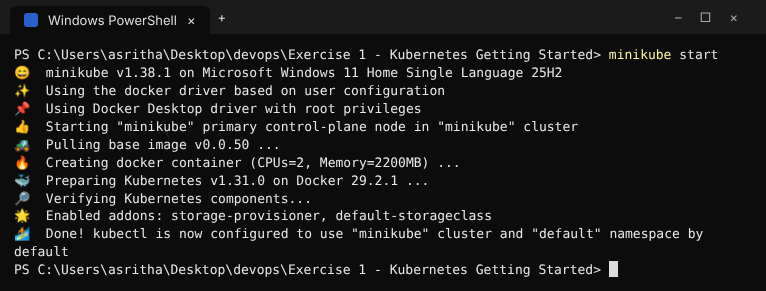
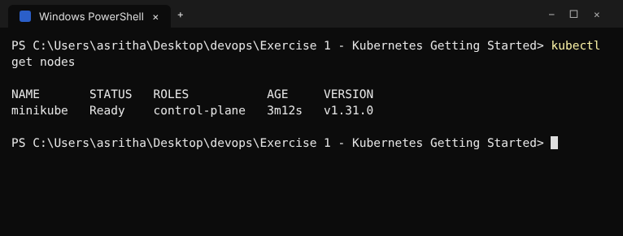
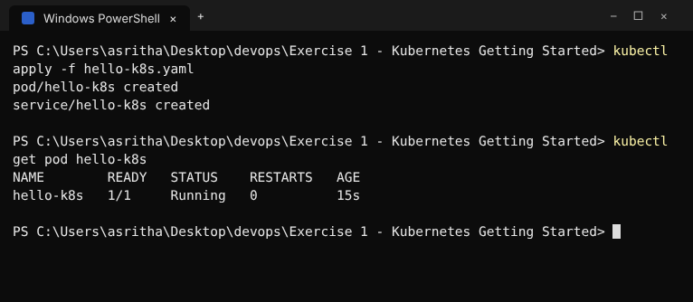
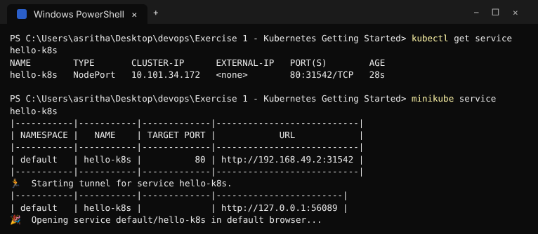
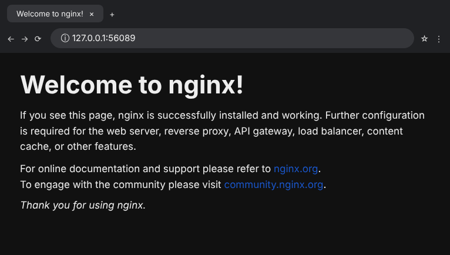
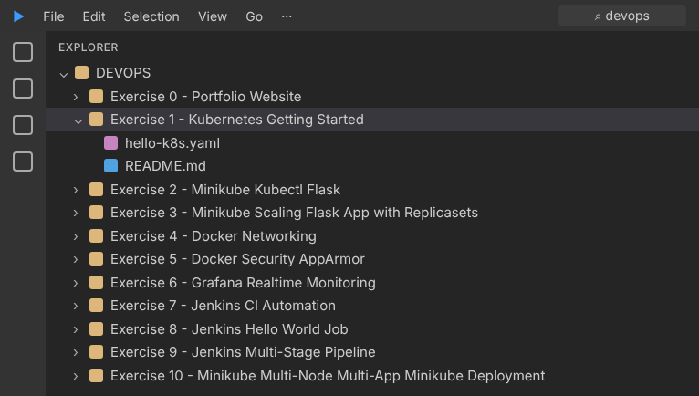

# Exercise 1 - Kubernetes Getting Started

This exercise deploys the Nginx storefront as a Kubernetes Pod and exposes it
through a NodePort Service.

## Deploy

```powershell
minikube start
kubectl apply -f hello-k8s.yaml
kubectl get pod hello-k8s
kubectl get service hello-k8s
minikube service hello-k8s
```

## Clean up

```powershell
kubectl delete -f hello-k8s.yaml
```

## Execution Evidence / Screenshots







