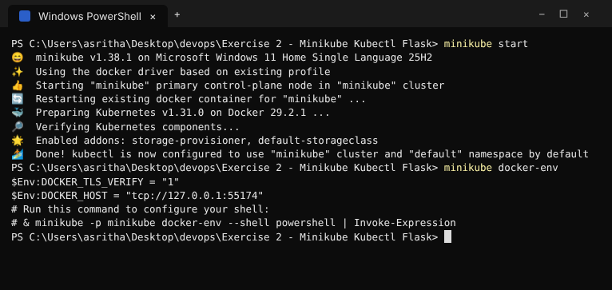
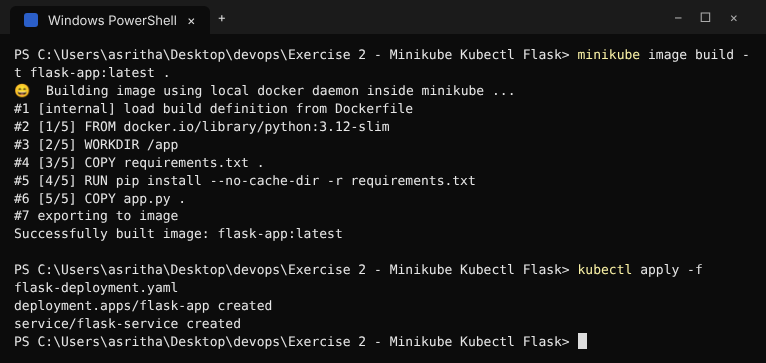
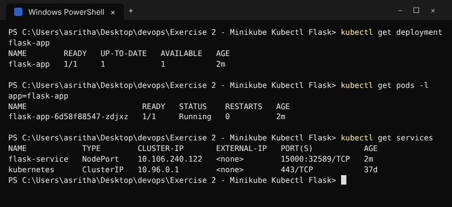
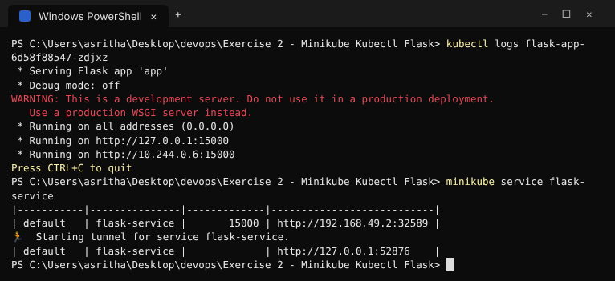
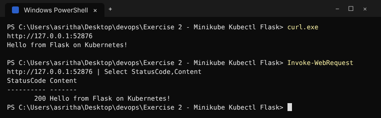
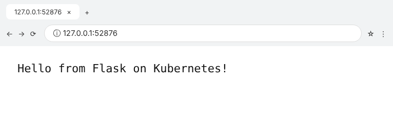
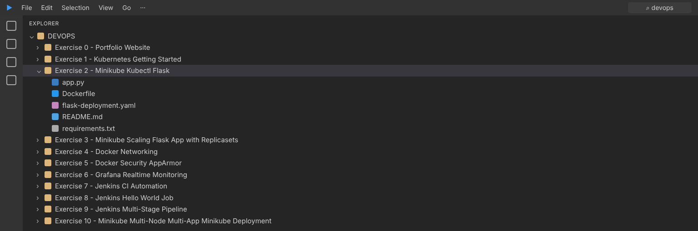

# Exercise 2 - Minikube Kubectl Flask

This exercise builds the supplied Flask application inside Minikube's Docker
daemon, deploys it with `kubectl`, and exposes port 15000 through a NodePort
Service.

## Build and deploy

```powershell
minikube start
minikube docker-env
minikube image build -t flask-app:latest .
kubectl apply -f flask-deployment.yaml
kubectl get deployment flask-app
kubectl get pods -l app=flask-app
minikube service flask-service
```

The image uses `imagePullPolicy: Never` because it is built in the local
Minikube image store rather than pulled from a registry.

## Clean up

```powershell
kubectl delete -f flask-deployment.yaml
```

## Execution Evidence / Screenshots








