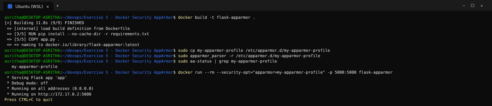
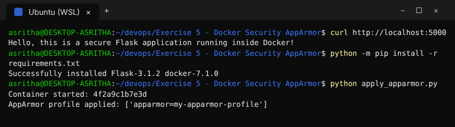
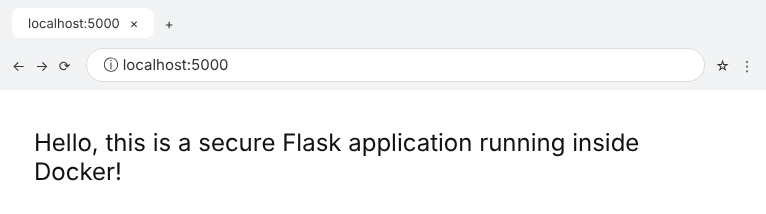
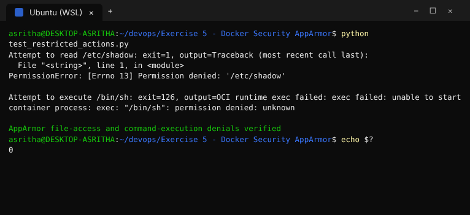
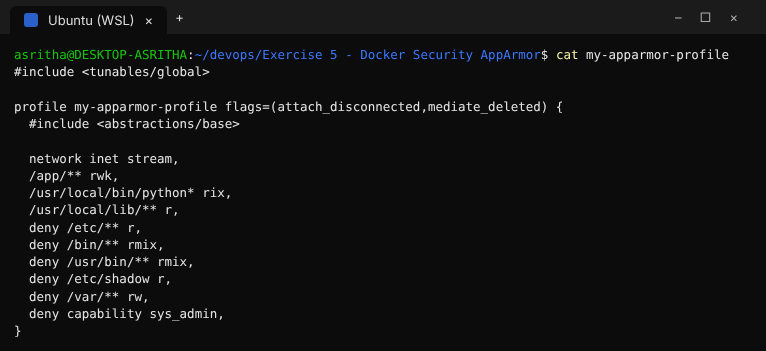
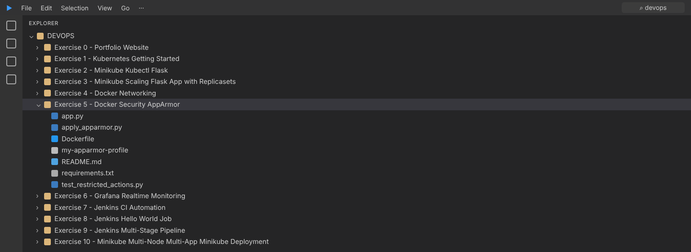

# Exercise 5 - Docker Security AppArmor

This exercise runs a Flask container with an AppArmor profile that limits
filesystem access and denies the `sys_admin` capability.

AppArmor is available on Linux/WSL hosts with AppArmor enabled. It is not
available as a native Docker Desktop security profile on Windows.

## Build and apply the profile

```bash
docker build -t flask-apparmor .
sudo cp my-apparmor-profile /etc/apparmor.d/my-apparmor-profile
sudo apparmor_parser -r /etc/apparmor.d/my-apparmor-profile
docker run --rm --security-opt="apparmor=my-apparmor-profile" -p 5000:5000 flask-apparmor
```

## Verify through the Docker SDK

```bash
python -m pip install -r requirements.txt
python apply_apparmor.py
python test_restricted_actions.py
```

The test attempts to read `/etc/shadow` and execute `/bin/sh`; AppArmor should
deny both operations. The test exits with failure if either operation succeeds
or fails for an unrelated reason.

## Execution Evidence / Screenshots







