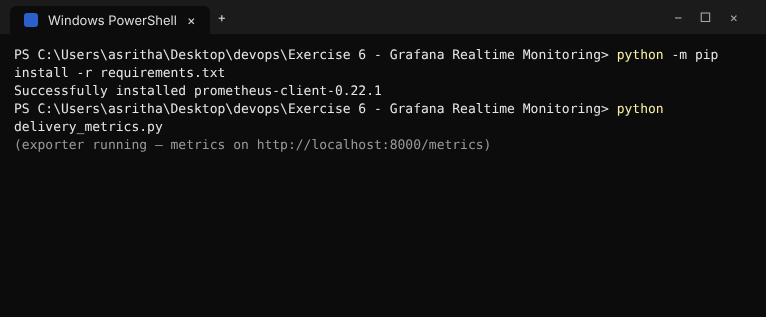
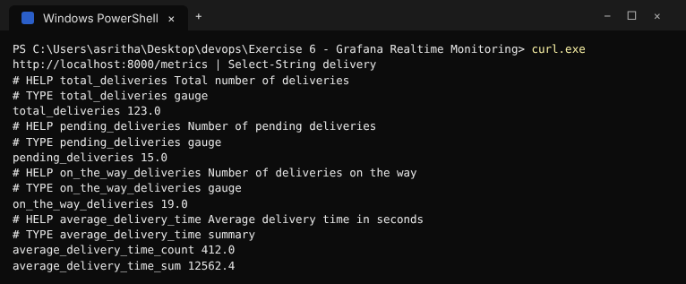
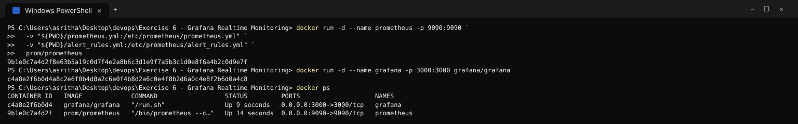
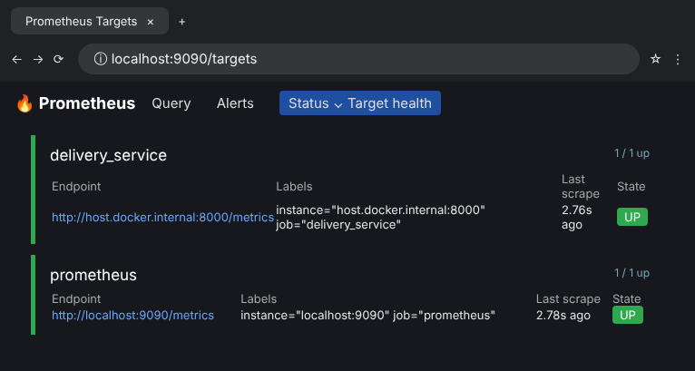
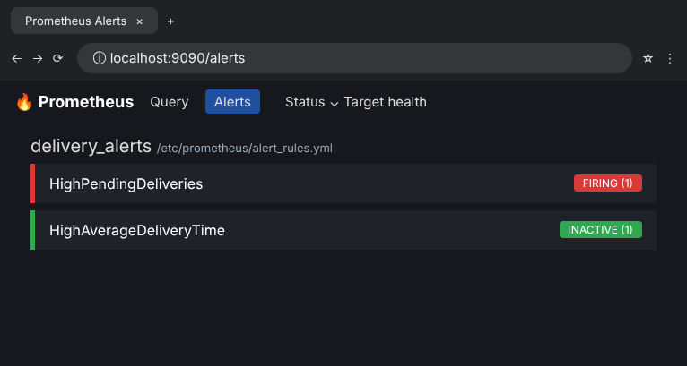
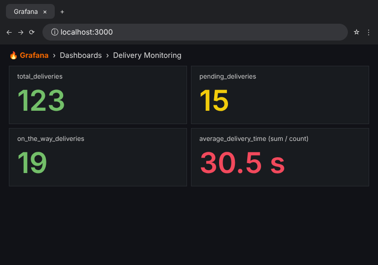
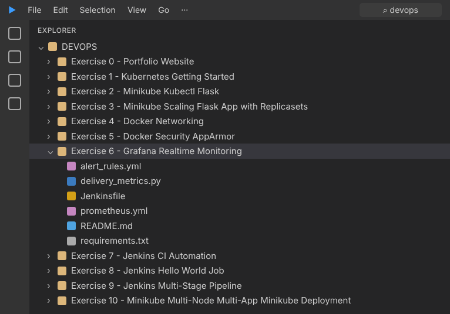

# Exercise 6 - Grafana Realtime Monitoring

This exercise exposes simulated quick-commerce delivery metrics for Prometheus,
defines alert rules, and provides a Jenkins validation pipeline.

## Run the metrics exporter

```powershell
python -m pip install -r requirements.txt
python delivery_metrics.py
```

Metrics are available at `http://localhost:8000/metrics`.

## Run Prometheus and Grafana

In another terminal:

```powershell
docker run -d --name prometheus -p 9090:9090 `
  -v "${PWD}/prometheus.yml:/etc/prometheus/prometheus.yml" `
  -v "${PWD}/alert_rules.yml:/etc/prometheus/alert_rules.yml" `
  prom/prometheus
docker run -d --name grafana -p 3000:3000 grafana/grafana
```

Open Prometheus at `http://localhost:9090` and Grafana at
`http://localhost:3000`. Add Prometheus as a Grafana data source with URL
`http://host.docker.internal:9090`, then build a panel using
`pending_deliveries` or `on_the_way_deliveries`.

## Clean up

```powershell
docker rm -f prometheus grafana
```

## Execution Evidence / Screenshots








