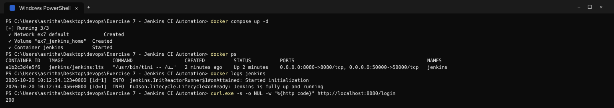
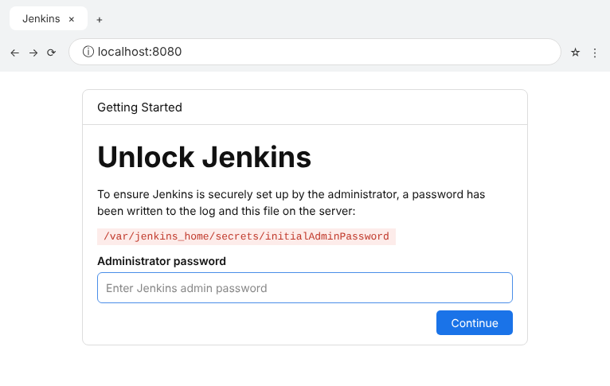
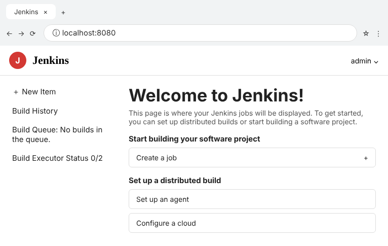
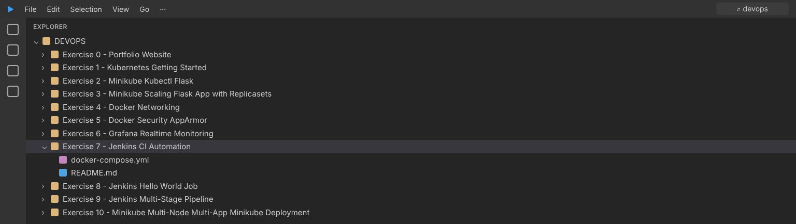

# Exercise 7 - Jenkins CI Automation

This exercise starts Jenkins for the remaining CI exercises and records the
initial setup without storing any administrator password or token.

## Start Jenkins

```powershell
docker compose up -d
docker logs jenkins
```

Open `http://localhost:8080`. Retrieve the one-time setup password only from
the local container when Jenkins requests it:

```bash
docker exec jenkins cat /var/jenkins_home/secrets/initialAdminPassword
```

Complete the setup wizard in the browser, install the suggested plugins, and
create the local administrator account there. Never commit the password or
personal access tokens.

## Stop Jenkins

```powershell
docker compose down
```

## Execution Evidence / Screenshots





