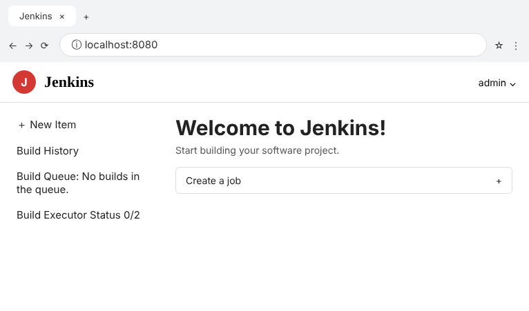
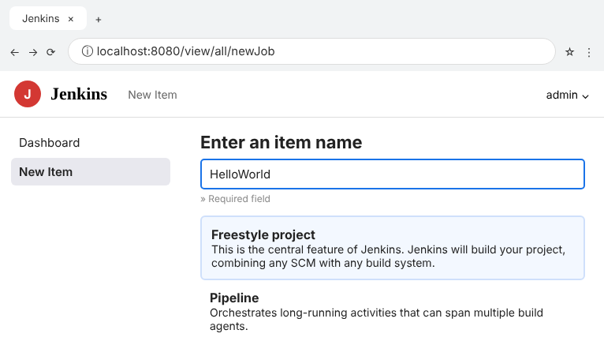
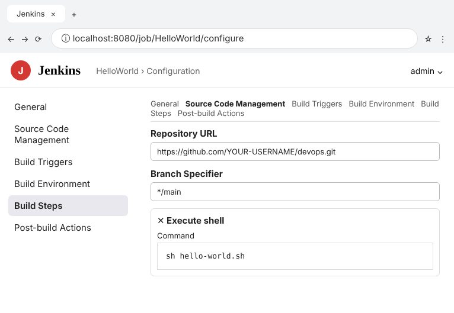
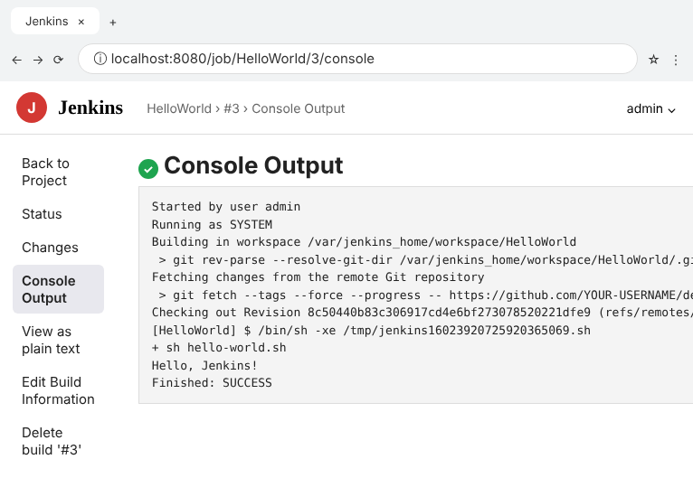
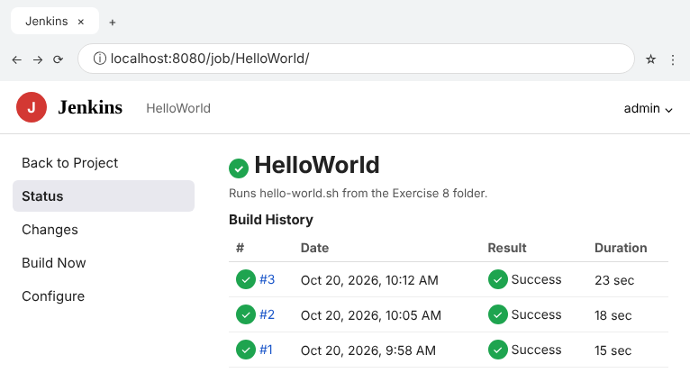
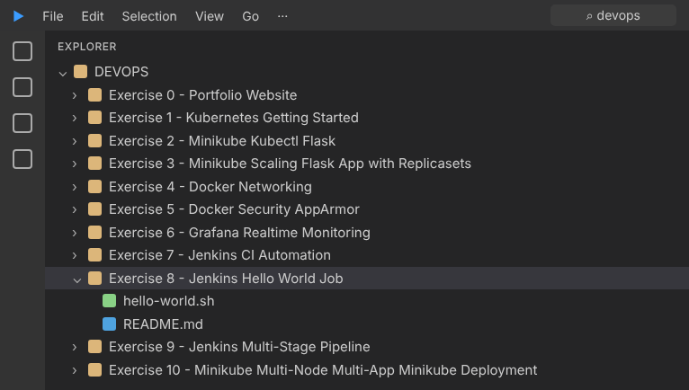

# Exercise 8 - Jenkins Hello World Job

This is the source repository for a Jenkins Freestyle job named
`HelloWorld`. The job checks out this folder and runs the build step below:

```bash
sh hello-world.sh
```

The successful console output must include:

```text
Hello, Jenkins!
Finished: SUCCESS
```

Create the job in Jenkins as a **Freestyle project**, configure Git source
control for this repository, add `sh hello-world.sh` under **Execute shell**,
save it, and select **Build Now**.

## Execution Evidence / Screenshots







